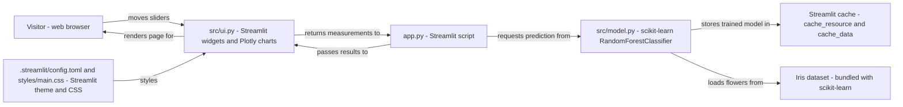

# Iris species classifier - Architecture and design rationale

*Last updated: 2026-11-07 · commit 8a9bd36d4*

## 1. Purpose and scope

A small Streamlit page that classifies an iris from four slider measurements. A random forest trained on the classic
150-flower Iris dataset names the most likely species, shows the probability for each species and plots the flower among
the 150 reference flowers. It is a learning and portfolio project that shows a complete, tested machine learning
interaction in one screen.

It is not a botanical tool, a benchmark of classifiers or a production service. The dataset is tiny and well separated,
so the page demonstrates the pattern (train once, cache, predict live, state honest accuracy) rather than a hard
modelling problem. Setup and usage are in the [README](../README.md).

## 2. How this project was built

This project was built with Claude Code (Anthropic's AI coding assistant) in a complementary role. Elliott Fairhall is
the author and owner: the project is debugged, tested and used by him for learning and development, and the design
decisions below are explained so that they can be understood, questioned and learned from. AI assistance does not
replace that work, and nothing in this repository should be read as an unreviewed, machine-only product. The commit
history records the assistant as a co-author on the commits that redesigned the page.

## 3. Architecture at a glance

- The only persistent state is the Streamlit cache; there is no network call.
- The dataset ships with scikit-learn, so nothing is fetched at run time.

Every slider movement makes Streamlit rerun `app.py` from the top. The script fetches the cached model, asks it for
class probabilities for the one-row measurement frame, and hands the result to the rendering functions in `src/ui.py`.
There is no server state beyond the cache and no network call.

## 4. Components

| Component    | Responsibility                                             | Key files                                   | Depends on                            |
| ------------ | ---------------------------------------------------------- | ------------------------------------------- | ------------------------------------- |
| Entry point  | Orders the page: config, intro, sidebar, result, charts    | `app.py`                                    | `src/model.py`, `src/ui.py`           |
| Model        | Train, predict, cross-validate, expose the reference frame | `src/model.py`                              | scikit-learn, pandas, Streamlit cache |
| Page layout  | Sliders, metrics, photo, two Plotly charts, footer         | `src/ui.py`                                 | Plotly, Streamlit, `src/utils.py`     |
| Helpers      | Project root path and CSS injection                        | `src/utils.py`                              | Streamlit                             |
| Theme        | Colours, fonts, light and dark modes                       | `.streamlit/config.toml`, `styles/main.css` | Streamlit                             |
| Manual check | Command-line smoke check of the model                      | `verify.py`                                 | `src/model.py`                        |
| Tests        | Model behaviour, headless page runs, dependency pins       | `tests/`                                    | pytest, Streamlit `AppTest`           |

`IrisModel` wraps a `RandomForestClassifier` with a fixed seed. Training is lazy and idempotent (`train()` returns
immediately if already fitted), and `get_model()` is the cached factory the page uses. `get_accuracy()` is a separate
cached function that builds a fresh forest and runs 5-fold cross-validation, so the figure on the page is never taken
from the model that serves predictions.

## 5. Data and control flow

1. Streamlit starts `app.py`. `render_config()` sets the page configuration and injects `styles/main.css`.
2. `get_model()` returns the shared trained model. The first call in a process loads the dataset and fits the forest;
   later calls, including other visitors' sessions, reuse it.
3. `get_accuracy()` runs once per process and returns the mean of five cross-validation folds; the intro sentence quotes
   it.
4. `render_sidebar()` draws four sliders whose ranges equal the dataset's observed minimum and maximum, and returns a
   one-row DataFrame.
5. `model.predict_proba()` returns three probabilities. The species with the highest probability is shown with its
   photo, and the probabilities are drawn as bars.
6. `render_context()` plots the user's flower (petal length against petal width) over the 150 reference flowers.

State lives in two places: the Streamlit cache (model, dataset, accuracy) and the widget values held by Streamlit's
session. On failure there is little to handle, because there is no network and no user-typed input; a missing species
photo is skipped by an existence check in `render_result()`.

## 6. Design rationale

### Streamlit is the whole front end

- **Why:** the UI is four sliders, two metrics and two charts. Streamlit lets one person build that in Python, with no
  JavaScript build and a rerun-on-change model that gives live predictions without a button.
- **Gave up:** fine control over layout and interaction, and a clean separation between UI and server. Every interaction
  reruns the whole script.
- **Alternative not taken:** a Flask or FastAPI service with a JavaScript front end, which is more flexible but is far
  more code for the same screen. Jupyter widgets would suit exploration but not a public page.
- **Evidence:** the README states the stack (`documented`); the reasons are `inferred from the code`.

### A random forest with default settings, trained on all 150 flowers

- **Why:** a forest gives per-class probabilities directly through `predict_proba`, needs no feature scaling and handles
  the slight overlap of versicolor and virginica. The page shows those probabilities, so a probabilistic classifier fits
  the brief. The only choice made is the seed (`random_state=42`).
- **Gave up:** no hyperparameter search and no held-out test set; the served model sees every row. Its probabilities
  come from a model fitted to the same data it is describing, so they are not calibrated confidence for unseen flowers.
- **Alternative not taken:** logistic regression or k-nearest neighbours would be simpler to explain and would also
  reach a similar accuracy on this dataset; they were not chosen, and no file says why.
- **Evidence:** the README states a random forest and the fixed seed (`documented`); the model-choice reasoning is
  `inferred from the code`.

### Accuracy is measured at start-up by cross-validation, and the page quotes it

- **Why:** a headline figure should be measured, not typed in. Five-fold cross-validation on a fresh forest estimates
  accuracy on flowers the model has not seen, which is the honest number to put beside live predictions.
- **Gave up:** some start-up work on the first run (five extra forest fits; not timed), and the figure describes the
  dataset, not real-world flowers.
- **Alternative not taken:** a train/test split (one noisy estimate on 30 flowers) or a hard-coded accuracy that could
  drift from the code.
- **Evidence:** commit `f3b4a2b89` ("a real cross-validated accuracy figure") and a test asserting the figure lies
  between 0.9 and 1.0 (`documented`).

### Cache the model and data with Streamlit's two cache decorators

- **Why:** reruns happen on every slider tick, so retraining each time would make the page sluggish. `st.cache_resource`
  holds the single trained model object shared by all sessions; `st.cache_data` holds the dataset and the accuracy
  number.
- **Gave up:** the cache is per-process and cleared on restart, and the model class now imports Streamlit.
- **Alternative not taken:** training once at import time with a module global, which is simpler but hides the lifecycle
  and gives no invalidation.
- **Evidence:** README ("trained once and cached") and commit `f3b4a2b89` (`documented`).

### Split into a model module, a UI module and a thin entry point

- **Why:** `app.py` reads as the page outline, `src/ui.py` holds rendering, and `src/model.py` holds everything about
  the classifier, so each can be read and changed alone. It is the smallest split that keeps the entry point readable.
- **Gave up:** `src/model.py` is not Streamlit-free (it imports `st` for caching), so the model tests need Streamlit
  installed; `src/utils.py` is a two-function module kept for symmetry with the sibling projects.
- **Alternative not taken:** a single `app.py`, or a pure model module with the cache wrappers in `app.py`.
- **Evidence:** `inferred from the code`.

### Native Streamlit theme plus a small stylesheet

- **Why:** fonts, colours, radius and chart colours are set in `.streamlit/config.toml`, which gives light and dark
  modes for free; `styles/main.css` covers only the breadcrumb, footer and spacing the theme cannot reach. The palette
  is shared with the sibling Data Flakes projects.
- **Gave up:** bespoke visual effects. A smoke test fails if the stylesheet contains a gradient or a heading contains
  emoji.
- **Alternative not taken:** a large injected stylesheet, which fights Streamlit upgrades.
- **Evidence:** commit `f3b4a2b89` and `tests/test_app_smoke_iris.py` (`documented`).

### Dependency floors without upper caps, and a test that guards the Pillow pin

- **Why:** a cap on Pillow is what kept a security fix out earlier, so floors are set to the tested versions and nothing
  is capped. `tests/test_pillow_security_iris.py` fails if a Pillow requirement allows a vulnerable release or
  `requires-python` allows 3.10.
- **Gave up:** newer dependency releases can break the app without warning; the headless tests are the safeguard.
- **Alternative not taken:** a pinned lock file, which stops drift but also stops security updates.
- **Evidence:** commits `5a374f93b`, `1d92103f9` and `f3b4a2b89`, and the test's docstring (`documented`). No project
  code imports Pillow; it is declared so that the floor is enforced (`inferred from the code`).

### Almost no error handling, because there is almost nothing to fail

- **Why:** the dataset ships with scikit-learn, the sliders are bounded to the dataset's range, and nothing is read from
  the network. The one defensive check is the species photo existence test.
- **Gave up:** no handling for a corrupt install or an unexpected `st.cache` failure.
- **Alternative not taken:** try/except wrappers around the model, which would add code with no failure to catch.
- **Evidence:** `inferred from the code`.

### Hosting on Streamlit Community Cloud

- **Why:** it deploys straight from a Python repository with no container or server to run.
- **Gave up:** control over the runtime. No deployment file is stored in the repository, so Python version and server
  settings live outside it.
- **Alternative not taken:** a container on a VM or a managed app service.
- **Evidence:** the README badge links a `streamlit.app` address; everything else is `inferred` (`TODO: verify`).

| Choice                        | Main benefit                 | Main cost                               |
| ----------------------------- | ---------------------------- | --------------------------------------- |
| Streamlit                     | Live UI in Python            | Whole-script reruns                     |
| Random forest, defaults       | Probabilities, no scaling    | No tuning, no held-out test             |
| Start-up cross-validation     | Honest quoted accuracy       | Extra first-run work                    |
| Streamlit caches              | Fast reruns                  | Per-process, couples model to Streamlit |
| Native theme                  | Light and dark for free      | Limited bespoke styling                 |
| No dependency caps plus guard | Security fixes reach the app | Upgrades can break it                   |

## 7. Quality and testing

The tests were read, not run, for this document. There are three test files:

- `tests/test_iris_behaviour.py`: 9 test functions. Typical setosa, versicolor and virginica flowers are classified
  correctly; probabilities sum to one; two separately trained models agree exactly; cross-validated accuracy lies
  between 0.9 and 1.0; the reference frame has 150 labelled flowers; the default sliders show "Iris setosa"; moving the
  sliders to versicolor values changes the result without a button press.
- `tests/test_app_smoke_iris.py`: 5 test functions run the real `app.py` headlessly with `AppTest` (no exception, a
  title, no emoji in headings, a balanced gradient-free stylesheet, light and dark theme sections present).
- `tests/test_pillow_security_iris.py`: 5 test functions, parametrised over requirement files, `pyproject.toml` files
  and bundled images (the Pillow range, the Python floor, the installed version, and that each image still decodes).

Not tested: the chart functions beyond "the page renders", slider boundary values, the missing-photo branch, probability
calibration, and `verify.py` (a manual script that duplicates part of the behaviour tests and prints rather than logs).
A failure would show as a pytest assertion or an `AppTest` exception message.

## 8. Constraints, limitations and known gaps

- The model is trained and scored on 150 flowers of three species; it is a teaching example, not a classifier for other
  irises.
- Displayed confidence comes from a forest fitted to all the data, so it is optimistic for unseen flowers.
- `predict_proba` is called on `.values`, so column names are ignored and the column order in `render_sidebar()` must
  match the dataset order. Nothing asserts this beyond the behaviour tests.
- `.streamlit/config.toml` sets `enableXsrfProtection = false` and `enableCORS = false`. The page has no forms or
  state-changing actions, but the reason is not recorded (`TODO: verify`).
- The hosted deployment's settings are not in the repository (`TODO: verify`).
- `src/utils.py` has no module docstring and `verify.py` uses `print`, unlike the rest of the code.

## 9. Running and extending

See the [README](../README.md) for setup, running and testing. To extend safely: keep the dataset column order in step
with `render_sidebar()`; add a new species only if the photo, the colour in `SPECIES_COLOURS` and the tests are updated
together; if the model is changed, update the 0.9 to 1.0 accuracy assertion and the intro wording at the same time.

## 10. Rationale (confirmed by the owner)

Confirmed by Elliott Fairhall on 2026-11-07. This reasoning was first reconstructed from the code and commit history;
the owner has since agreed it is correct, so it is now the stated rationale rather than an inference.

- The random forest was chosen for its native probabilities and lack of scaling, not by comparing it with simpler
  models.
- Training on all 150 rows (with cross-validation only for the quoted figure) was a deliberate simplification for a
  demo.
- `src/model.py` imports Streamlit for caching on purpose, to keep the cache close to the code that it protects.
- Port numbers 8501 to 8505 across the sibling projects were chosen so that they can run side by side locally.
- Disabling XSRF protection and CORS in the Streamlit config was intended for hosting convenience, not for a specific
  need.
